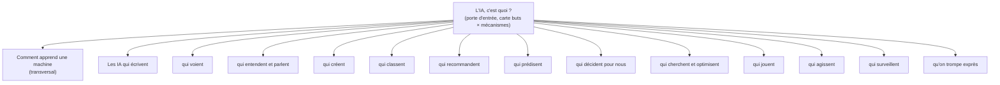

# Feuille de route

Principe : **sortir un module phare complet avant d'élargir.**

## Phase 0 — Fondations

- [x] Vision, liste des personnes, choix techniques
- [x] Squelette du site (Astro, statique) déployable sur cPanel
- [x] Charte graphique : palette, typographie, style d'illustration des « rouages » ([`CHARTE.md`](CHARTE.md))
- [x] Charte des sources et composant d'encart sources/date
- [x] Composants de base : bloc à niveaux 🟢🟡🔴 (`Niveaux`, `SelecteurNiveau`), terme de glossaire (`Terme`), étape (`Etape`)
- [x] Déploiement automatique vers cPanel (FTP) configuré

## Phase 1 — Module phare : « De l'Entrée à la page »

- [x] Scénario pas-à-pas (brouillon) : [`scenarios/entree-a-la-page.md`](scenarios/entree-a-la-page.md)
- [x] Vérification et sourçage des faits techniques du scénario
- [x] Relecture technique et grand public de la page et des animations (relecture assistée : 8 erreurs et 22 imprécisions techniques corrigées, 7 corrections et 19 améliorations de clarté, 13 termes ajoutés au glossaire)
- [x] Page du module avec frise des étapes et curseur de niveau : `/modules/entree-a-la-page/`
- [x] Animation « Les pots de peinture » (étape 4, échange de clés)
- [x] Animation « La question qui rebondit » (étape 1, DNS : trois situations)
- [x] Animation « Le voyage des paquets » (étape 5 : routes de secours, coupures, TTL et traceroute)
- [x] Animations des six autres scènes : barre d'adresse, box et NAT, poignée de main TCP, serveur et hôtes virtuels, compteur de requêtes (mesure en direct), affichage
- [x] Variante « serveur lointain » du voyage des paquets, par câble sous-marin (délai minimal sourcé)
- [x] Encarts « Qui décide ? » à chaque étape (ICANN, IETF, opérateurs…)
- [x] Encarts « Histoire » à chaque étape (CYCLADES, Feinler, Perlman…)
- [x] Glossaire : 34 premiers termes, page `/glossaire/`
- [ ] Relecture humaine finale (technique et grand public), une fois le site en ligne sur rouages.net
- [ ] Relever les exemples réels (`dig`, certificat, `curl -I`, protocole HTTP/2 ou HTTP/3, `traceroute`) sur le site en ligne
- [ ] **Lancement public**

## Phase 2 — Comment marche un ordinateur

- [x] Scénario en 8 étapes (`docs/scenarios/ordinateur.md`) et dossier de sources
- [x] Binaire et octet, transistor, portes logiques, additionneur
- [x] Mémoire (verrou et mémoire vive), horloge
- [x] Mini-processeur 4 bits pas-à-pas, programmable
- [x] Du langage humain aux bits (mini-processeur et RISC-V)
- [x] Glossaire : 8 termes ajoutés (bit, transistor, porte logique, processeur…)
- [ ] Relecture humaine finale

## Phase 3 — Qui décide (cartographie des acteurs)

- [ ] Carte interactive des acteurs et des rapports de force
- [ ] Fiches institutions (IETF, ICANN, W3C, RIR, CNIL, Arcom…)

## Phase 4 — Les histoires

- [ ] Composant de frise filtrable (région, thème, personnes)
- [ ] Informatique · Internet · IA

## Phase 5 — L'IA

Une famille de modules, rangés **par but** (ce que l'IA fait pour nous), avec
un module transversal **par mécanisme** (comment elle le fait). La porte
d'entrée croise les deux dans une carte : chaque module indique ses
mécanismes, chaque mécanisme renvoie vers les buts où il sert.

### Les IA qui écrivent (`/modules/ia-texte/`)

- [x] Scénario en 8 étapes (`docs/scenarios/ia-texte.md`) et dossier de sources (`docs/sources/ia-mecanismes.md`)
- [x] Mini-modèle dans le navigateur (`src/lib/minilm.ts`) : n-gramme, BPE, softmax et température, perceptron
- [x] Mot suivant, tokens, plongements, neurone, descente de gradient, attention, température, chaîne de fabrication
- [x] Glossaire : 10 termes (token, plongement, attention, transformeur, hallucination…)
- [ ] Relecture humaine finale
- [ ] Vérifier sur EUR-Lex la référence du règlement « Omnibus IA » (2026) citée par un cabinet d'avocats

### À venir (ordre prévu)

- [x] **L'IA, c'est quoi ?** (`/modules/ia/`, relecture humaine à faire) — définitions (et pourquoi elles changent), IA à règles et IA qui apprend, trois façons d'apprendre, carte buts × mécanismes, hivers et printemps de l'IA, idée reçue « tout est de l'IA »
- [ ] **Comment apprend une machine** *(transversal)* — neurone et descente de gradient (déplacés depuis « Les IA qui écrivent »), données d'entraînement et de test, sur-apprentissage, apprentissage supervisé, non supervisé, par renforcement
- [ ] **Les IA qui classent** — spam, diagnostic, tri de CV : Bayes naïf (un filtre anti-spam qu'on entraîne soi-même), arbres de décision, plus proches voisins
- [ ] **Les IA qui cherchent et optimisent** — GPS, tournées, emplois du temps : recherche A* ; IA inspirées de la nature : algorithmes génétiques, colonies de fourmis, essaims
- [ ] **Les IA qui voient** — images en nombres, convolutions (Fukushima, LeCun), ImageNet, reconnaissance faciale et biais
- [ ] **Les IA qui entendent et parlent** — reconnaissance vocale, synthèse de la voix, sous-titres automatiques
- [ ] **Les IA qui créent** — images (diffusion : le débruitage), musique ; droit d'auteur
- [ ] **Les IA qui recommandent** — fil d'actualité, vidéos, achats : filtrage collaboratif (reprend le module « Les algorithmes du quotidien » prévu dans la vision)
- [ ] **Les IA qui prédisent** — météo, consommation, police prédictive : séries temporelles, corrélation et causalité
- [ ] **Les IA qui décident pour nous** — crédit, aides sociales, justice : boîte noire ou modèle explicable (réseaux bayésiens, arbres, systèmes experts), droit à l'explication, biais
- [ ] **Les IA qui jouent** — recherche dans l'arbre des coups (Deep Blue), apprentissage par renforcement (AlphaGo)
- [ ] **Les IA qui agissent** — robots, voitures autonomes : perception, planification, renforcement
- [ ] **Les IA qui surveillent** — détection de fraude, vidéosurveillance algorithmique ; cadre légal
- [ ] **Les IA qu'on trompe exprès** — images piégées, attaques par instructions cachées (*prompt injection*), empoisonnement des données

## En parallèle — Jeux et idées reçues

- [x] Terminus : lien vers l'original du MIT
- [x] Terminus : prototype français jouable (`ls`, `cd`, `pwd`, `cat`, `mv`, `ls -a`, Tab, historique)
- [x] Terminus : moteur à chapitres (`src/scripts/terminus/`), scénario `docs/scenarios/terminus.md`
- [x] Terminus : chapitre 1 « L'Éveil » (`ls`, `cd`, `pwd`, `cat`/`less`, `ls -a`, `mv` pour déplacer et renommer)
- [x] Terminus : chapitre 2 « Le Bourg » (`grep`, `touch`, `cp`, `mkdir`, `rm`, jokers `*`)
- [x] Terminus : sauvegarde de la progression dans le navigateur (par chapitre)
- [x] Terminus : chapitre 3 « La Racine » (`ls -l`, `chmod`, `whoami`, `sudo`, permissions) — fin de l'histoire de l'Effaceur
- [x] Terminus : moteur avec tubes `|`, redirections `>` `>>`, guillemets, sortie d'erreur séparée
- [x] Terminus : histoire « Le Datacenter » (`head`, `tail`, `wc`, `cut`, `sort`, `uniq`, `tee`, `ps`, `kill`, `systemctl`)
- [x] Terminus : histoire « Le Paquet perdu » (`ping`, `dig`, `traceroute`, `curl`)
- [x] Terminus : histoire « La Machine à remonter le temps » (`git`)
- [x] Terminus : histoire « Les Archives » (`du`, `df`, `find`, `tar`)
- [ ] Terminus : suites possibles (voir « Idées pour la suite » dans le scénario)
- [ ] Idées reçues : 10 premières fiches « Vrai ou faux ? »

## Ensuite

- Matérialité (câbles, datacenters, énergie)
- Sécurité & vie privée
- Algorithmes du quotidien
- Le dark net : routage en oignon, `.onion`, usages et limites
- Savoirs : édition scientifique, libre accès, Sci-Hub et Alexandra Elbakyan, communs de la connaissance
- Économie du net
- Version anglaise
