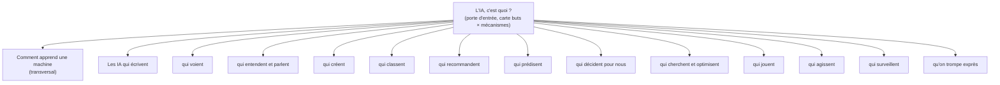

# Feuille de route

Principe : **sortir un module phare complet avant d'élargir.**

## Phase 0 — Fondations

- [x] Vision, liste des personnes, choix techniques
- [x] Squelette du site (Astro, statique) déployable sur cPanel
- [x] Charte graphique : palette, typographie, style d'illustration des « rouages » ([`CHARTE.md`](CHARTE.md))
- [x] Charte des sources et composant d'encart sources/date
- [x] Composants de base : bloc à niveaux 🟢🟡🔴 (`Niveaux`, `SelecteurNiveau`), terme de glossaire (`Terme`), étape (`Etape`)
- [x] Déploiement automatique vers cPanel (FTP) configuré

## Phase 1 — Module phare : « De l'Entrée à la page »

- [x] Scénario pas-à-pas (brouillon) : [`scenarios/entree-a-la-page.md`](scenarios/entree-a-la-page.md)
- [x] Vérification et sourçage des faits techniques du scénario
- [x] Relecture technique et grand public de la page et des animations (relecture assistée : 8 erreurs et 22 imprécisions techniques corrigées, 7 corrections et 19 améliorations de clarté, 13 termes ajoutés au glossaire)
- [x] Page du module avec frise des étapes et curseur de niveau : `/modules/entree-a-la-page/`
- [x] Animation « Les pots de peinture » (étape 4, échange de clés)
- [x] Animation « La question qui rebondit » (étape 1, DNS : trois situations)
- [x] Animation « Le voyage des paquets » (étape 5 : routes de secours, coupures, TTL et traceroute)
- [x] Animations des six autres scènes : barre d'adresse, box et NAT, poignée de main TCP, serveur et hôtes virtuels, compteur de requêtes (mesure en direct), affichage
- [x] Variante « serveur lointain » du voyage des paquets, par câble sous-marin (délai minimal sourcé)
- [x] Encarts « Qui décide ? » à chaque étape (ICANN, IETF, opérateurs…)
- [x] Encarts « Histoire » à chaque étape (CYCLADES, Feinler, Perlman…)
- [x] Glossaire : 34 premiers termes, page `/glossaire/`
- [ ] Relecture humaine finale (technique et grand public), une fois le site en ligne sur rouages.net
- [ ] Relever les exemples réels (`dig`, certificat, `curl -I`, protocole HTTP/2 ou HTTP/3, `traceroute`) sur le site en ligne
- [ ] **Lancement public**

## Phase 2 — Comment marche un ordinateur

- [x] Scénario en 8 étapes (`docs/scenarios/ordinateur.md`) et dossier de sources
- [x] Binaire et octet, transistor, portes logiques, additionneur
- [x] Mémoire (verrou et mémoire vive), horloge
- [x] Mini-processeur 4 bits pas-à-pas, programmable
- [x] Du langage humain aux bits (mini-processeur et RISC-V)
- [x] Glossaire : 8 termes ajoutés (bit, transistor, porte logique, processeur…)
- [ ] Relecture humaine finale

## Phase 3 — Qui décide (cartographie des acteurs)

- [ ] Carte interactive des acteurs et des rapports de force
- [ ] Fiches institutions (IETF, ICANN, W3C, RIR, CNIL, Arcom…)

## Phase 4 — Les histoires

- [ ] Composant de frise filtrable (région, thème, personnes)
- [ ] Informatique · Internet · IA

## Phase 5 — L'IA

Une famille de modules, rangés **par but** (ce que l'IA fait pour nous), avec
un module transversal **par mécanisme** (comment elle le fait). La porte
d'entrée croise les deux dans une carte : chaque module indique ses
mécanismes, chaque mécanisme renvoie vers les buts où il sert.

### Les IA qui écrivent (`/modules/ia-texte/`)

- [x] Scénario (`docs/scenarios/ia-texte.md`), 7 étapes depuis le déplacement du neurone et de la descente de gradient, et dossier de sources (`docs/sources/ia-mecanismes.md`)
- [x] Mini-modèle dans le navigateur (`src/lib/minilm.ts`) : n-gramme, BPE, softmax et température, perceptron
- [x] Mot suivant, tokens, plongements, neurone, descente de gradient, attention, température, chaîne de fabrication
- [x] Glossaire : 10 termes (token, plongement, attention, transformeur, hallucination…)
- [ ] Relecture humaine finale
- [x] Vérifier sur EUR-Lex la référence du règlement « Omnibus IA » : règlement (UE) 2026/1744 du 8 juillet 2026 (JO du 24.7.2026), obligations à haut risque de l'annexe III au 2 décembre 2027 (voir `docs/sources/ia-classer.md`, § 8)

### Page d'entrée

- [x] Page `/ia/` : introduction, parcours conseillé, modules par but (générés depuis `src/lib/carte-ia.ts`) ; une seule carte « L'IA » sur l'accueil et un lien dans le menu

### À venir (ordre prévu)

- [x] **L'IA, c'est quoi ?** (`/modules/ia/`, relecture humaine à faire) — définitions (et pourquoi elles changent), IA à règles et IA qui apprend, trois façons d'apprendre, carte buts × mécanismes, hivers et printemps de l'IA, idée reçue « tout est de l'IA »
- [x] **Comment apprend une machine** *(transversal, `/modules/apprendre/`, relecture humaine à faire)* — neurone et descente de gradient (déplacés depuis « Les IA qui écrivent »), données d'entraînement et de test, sur-apprentissage, apprentissage supervisé, non supervisé, par renforcement
- [x] **Les IA qui classent** *(`/modules/ia-classer/`, relecture humaine à faire)* — spam, diagnostic, tri de CV : Bayes naïf (un filtre anti-spam qu'on entraîne soi-même), arbres de décision, plus proches voisins
- [x] **Les IA qui cherchent et optimisent** *(`/modules/ia-chercher/`, relecture humaine à faire)* — GPS, tournées, emplois du temps : recherche A* ; IA inspirées de la nature : algorithmes génétiques, colonies de fourmis, essaims
- [x] **Les IA qui voient** *(`/modules/ia-voir/`, relecture humaine à faire)* — images en nombres, convolutions (Fukushima, LeCun), ImageNet, reconnaissance faciale et biais
- [x] **Les IA qui entendent et parlent** *(`/modules/ia-entendre/`, relecture humaine à faire)* — reconnaissance vocale, synthèse de la voix, sous-titres automatiques
- [x] **Les IA qui créent** *(`/modules/ia-creer/`, relecture humaine à faire ; état des procès à mettre à jour)* — images (diffusion : le débruitage), musique ; droit d'auteur
- [x] **Les IA qui recommandent** *(`/modules/ia-recommander/`, relecture humaine à faire ; procédures européennes à suivre)* — fil d'actualité, vidéos, achats : filtrage collaboratif (reprend le module « Les algorithmes du quotidien » prévu dans la vision)
- [x] **Les IA qui prédisent** *(`/modules/ia-predire/`, relecture humaine à faire ; cadre légal de la police prédictive à suivre)* — météo, consommation, police prédictive : séries temporelles, corrélation et causalité
- [x] **Les IA qui décident pour nous** *(`/modules/ia-decident/`, relecture humaine à faire ; recours contre l'algorithme de la CNAF à suivre)* — crédit, aides sociales, justice : boîte noire ou modèle explicable (réseaux bayésiens, arbres, systèmes experts), droit à l'explication, biais
- [x] **Les IA qui jouent** *(`/modules/ia-jouent/`, relecture humaine à faire)* — recherche dans l'arbre des coups (Deep Blue), apprentissage par renforcement (AlphaGo)
- [x] **Les IA qui agissent** *(`/modules/ia-agir/`, relecture humaine à faire ; robotaxis et armes autonomes à suivre)* — robots, voitures autonomes : perception, planification, renforcement
- [x] **Les IA qui surveillent** *(`/modules/ia-surveiller/`, relecture humaine à faire ; cadre légal de la vidéosurveillance algorithmique à suivre)* — détection de fraude, vidéosurveillance algorithmique ; cadre légal
- [x] **Les IA qu'on trompe exprès** *(`/modules/ia-trompe/`, relecture humaine à faire)* — images piégées, attaques par instructions cachées (*prompt injection*), empoisonnement des données

## Phase 5 bis — Recommander (avec ou sans IA)

- [x] Page d'entrée `/recommandation/` et carte sur l'accueil ; dossier de sources [`sources/recommander-sans-ia.md`](sources/recommander-sans-ia.md)
- [x] **Avant les algorithmes** *(`/modules/avant-algorithmes/`, relecture humaine à faire)* — bibliothécaires et classifications (Dewey et ses biais, Ranganathan), Guide Michelin, hit-parades (Billboard, Oricon), payola, clubs de livres
- [x] **Classer par les notes** *(`/modules/classer-notes/`, relecture humaine à faire ; règles sur les faux avis à suivre)* — moyenne trompeuse, borne de Wilson, moyenne bayésienne (IMDb), tri « tendance » (Reddit, Hacker News), avis en J, faux avis et droit
- [x] **PageRank : les liens comme des votes** *(`/modules/pagerank/`, relecture humaine à faire ; procédures de concurrence à suivre)* — surfeur aléatoire, ancêtres (Katz, Pinski et Narin, Garfield, RankDex de Robin Li, HITS), fermes de liens, procédures antitrust (à dater)
- [x] **Les IA qui recommandent** (voir phase 5)

## Phase 5 ter — L'intelligence collective (avec ou sans IA)

- [x] Page d'entrée `/intelligence-collective/` et carte sur l'accueil ; dossier de sources [`sources/intelligence-collective.md`](sources/intelligence-collective.md)
- [x] **La sagesse des foules** *(`/modules/sagesse-des-foules/`, relecture humaine à faire)* — le bœuf de Galton (chiffres corrigés par Wallis), théorème du jury de Condorcet, cascades informationnelles, influence sociale (Lorenz et al.)
- [x] **Construire ensemble** *(`/modules/construire-ensemble/`, relecture humaine à faire)* — GNU et Linux, Wikipédia (écart de genre), OpenStreetMap et Haïti, Galaxy Zoo, Foldit, Ushahidi, Common Voice, Masakhane, Elinor Ostrom
- [x] **Délibérer avec des algorithmes** *(`/modules/deliberer/`, relecture humaine à faire)* — Polis et vTaiwan, Community Notes (algorithme de « pont », études divergentes, à dater), conventions citoyennes, Porto Alegre
- [x] **L'IA, fruit d'une intelligence collective** *(`/modules/ia-collective/`, relecture humaine à faire)* — données du web, reCAPTCHA, annotation et travail invisible, retours humains (RLHF), IA d'aide à la délibération

## Phase 5 quater — Penser la technique (expériences de pensée et philosophie)

Les grandes questions sur l'IA, la technique, les télécommunications et
internet, à partir d'expériences de pensée qu'on manipule : chaque module
propose une animation (un petit monde où l'expérience se joue), puis les
objections et les réponses. Toutes les positions présentées ; attributions
vérifiées (pas de « premier·e » ni d'auteur unique sans source) ; penseuses et
pensées non occidentales mises en avant. Dates et attributions ci-dessous à
vérifier lors de la recherche.

- [x] Page d'entrée `/penser-la-technique/` et carte sur l'accueil ; dossier de sources [`sources/penser-la-technique.md`](sources/penser-la-technique.md)
- [x] **Les objectifs mal posés** *(`/modules/objectifs-mal-poses/`, relecture humaine à faire)* — le roi Midas et l'apprenti sorcier, le maximiseur de trombones (Bostrom), la loi de Goodhart, des cas réels d'IA qui « trichent » sur un objectif mal formulé ; débat sur le risque existentiel face aux torts actuels (toutes les positions). Animation : un optimiseur dans un petit monde, avec un objectif à corriger
- [x] **Une machine peut-elle penser ?** *(`/modules/machine-pense/`, relecture humaine à faire)* — le jeu de l'imitation de Turing (1950) et « l'objection de Lady Lovelace », la chambre chinoise (Searle, 1980), l'effet ELIZA (Weizenbaum), les « perroquets stochastiques » (Bender, Gebru et al., 2021). Animation : une chambre chinoise qui répond avec un livre de règles
- [x] **Les choix moraux** *(`/modules/choix-moraux/`, relecture humaine à faire)* — le dilemme du tramway (Philippa Foot, Judith Jarvis Thomson), Moral Machine et ses limites, le voile d'ignorance (Rawls) appliqué aux algorithmes. Animation : tes choix comparés à ceux de Moral Machine
- [x] **La technique est-elle neutre ?** *(`/modules/technique-neutre/`, relecture humaine à faire ; Collingridge et McLuhan ajoutés en complément)* — lois de Kranzberg, « Les artefacts font-ils de la politique ? » (Winner, et la controverse sur les ponts de Moses), « Code is law » (Lessig) contre la Déclaration d'indépendance du cyberespace (Barlow), dilemme de Collingridge, « Le médium est le message » (McLuhan), paradoxe de Jevons. Animations : Jevons (plus d'efficacité, plus de consommation), Collingridge (trop tôt pour savoir, trop tard pour changer)
- [x] **Surveillance et vie privée** *(`/modules/surveillance-vie-privee/`, relecture humaine à faire)* — le panoptique (Bentham, Foucault), « Je n'ai rien à cacher » et ses réfutations ; lien avec « Les IA qui surveillent »
- [x] **Des regards venus d'ailleurs** *(`/modules/regards-ailleurs/`, relecture humaine à faire)* — éthique ubuntu et IA, « cosmotechnique » (Yuk Hui), protocoles autochtones pour l'IA, critiques de Ruha Benjamin et Kate Crawford

## En parallèle — Jeux et idées reçues

- [x] Terminus : lien vers l'original du MIT
- [x] Terminus : prototype français jouable (`ls`, `cd`, `pwd`, `cat`, `mv`, `ls -a`, Tab, historique)
- [x] Terminus : moteur à chapitres (`src/scripts/terminus/`), scénario `docs/scenarios/terminus.md`
- [x] Terminus : chapitre 1 « L'Éveil » (`ls`, `cd`, `pwd`, `cat`/`less`, `ls -a`, `mv` pour déplacer et renommer)
- [x] Terminus : chapitre 2 « Le Bourg » (`grep`, `touch`, `cp`, `mkdir`, `rm`, jokers `*`)
- [x] Terminus : sauvegarde de la progression dans le navigateur (par chapitre)
- [x] Terminus : chapitre 3 « La Racine » (`ls -l`, `chmod`, `whoami`, `sudo`, permissions) — fin de l'histoire de l'Effaceur
- [x] Terminus : moteur avec tubes `|`, redirections `>` `>>`, guillemets, sortie d'erreur séparée
- [x] Terminus : histoire « Le Datacenter » (`head`, `tail`, `wc`, `cut`, `sort`, `uniq`, `tee`, `ps`, `kill`, `systemctl`)
- [x] Terminus : histoire « Le Paquet perdu » (`ping`, `dig`, `traceroute`, `curl`)
- [x] Terminus : histoire « La Machine à remonter le temps » (`git`)
- [x] Terminus : histoire « Les Archives » (`du`, `df`, `find`, `tar`)
- [x] ~~Terminus : suites possibles~~ — déplacé dans le dépôt de Quêtes de Sysadmin (feuille de route du jeu)
- [ ] Idées reçues : 10 premières fiches « Vrai ou faux ? »
- [x] Page `/jeux/` : jeux pour apprendre, classés par thème (74 jeux vérifiés les 17, 24 et 25 octobre 2026, filtres « en français », « gratuits », « sans compte ») ; à revérifier régulièrement
- [x] Terminus devient un projet séparé, « Quêtes de Sysadmin » (dépôt `Rouages-du-net/quetes-de-sysadmin`, site sysadmin.rouages.net) ; la page `/jeux/quetes-de-sysadmin/` l'intègre sans copier son code, `/jeux/terminus/` y redirige, et la progression des joueur·ses est gardée (clé `rouages-terminus`)

## Ensuite

- Matérialité (câbles, datacenters, énergie)
- Sécurité & vie privée
- Le dark net : routage en oignon, `.onion`, usages et limites
- Savoirs : édition scientifique, libre accès, Sci-Hub et Alexandra Elbakyan, communs de la connaissance
- Économie du net
- Version anglaise
