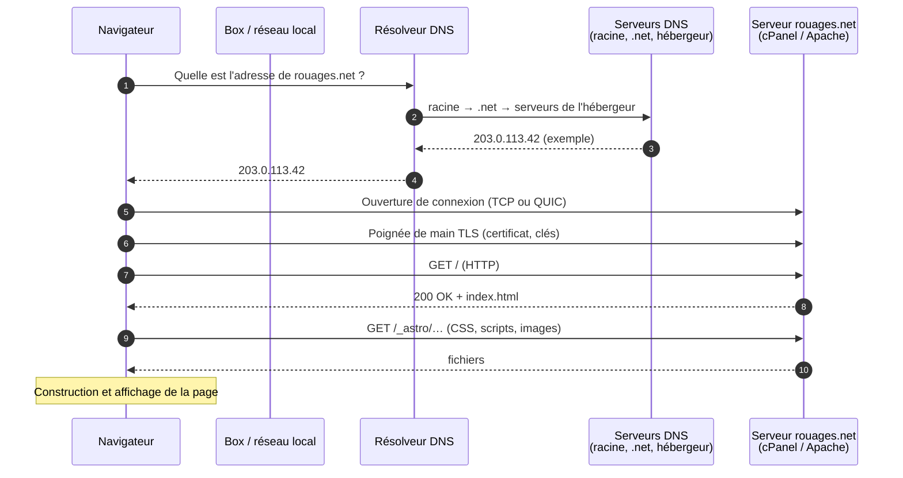

# Scénario — « De l'Entrée à la page »

Module phare des *Rouages du net*. Statut : **brouillon de scénario**, faits
techniques vérifiés le 11 octobre 2026 (voir
[`sources/entree-a-la-page.md`](../sources/entree-a-la-page.md)) ; reste à
faire relire (technique + grand public) avant la réalisation.

## Intention

Suivre pas à pas ce qui se passe entre le moment où l'on appuie sur
<kbd>Entrée</kbd> après avoir tapé `rouages.net` et le moment où la page
s'affiche. En une à deux secondes, des dizaines de machines, d'organisations
et de règles entrent en jeu. On les montre **toutes**, à trois niveaux de
lecture, avec la vraie technologie à portée de clic.

**Le fil conducteur, c'est le site lui-même** : la page que l'on suit est
celle du site, hébergée sur un serveur cPanel. Le visiteur peut vérifier
chaque étape sur son propre ordinateur (encarts « Vérifie toi-même »).

> ℹ️ **Domaine.** `rouages.net` appartient au projet. Au 11 octobre 2026, il
> sert encore l'ancien site WordPress, en cours de migration ailleurs. Les
> exemples réels (DNS, certificat, `curl`, `traceroute`) seront relevés une
> fois le nouveau site en ligne.

## Objectifs pédagogiques

À la fin du module, le visiteur sait :

1. qu'un nom de domaine est traduit en adresse IP par un système mondial
   et décentralisé (le DNS) ;
2. que les données voyagent en **paquets**, par des routes que personne ne
   choisit à l'avance de bout en bout ;
3. que le cadenas signifie « connexion chiffrée avec le bon serveur », pas
   « site digne de confiance » ;
4. qu'internet est **physique** : box, câbles, routeurs, câbles sous-marins,
   datacenters ;
5. qui décide quoi à chaque étape (ICANN, registres, opérateurs, autorités
   de certification, navigateurs, régulateurs) ;
6. que ces techniques ont une histoire, faite aussi par des personnes
   oubliées (Feinler, Pouzin, Perlman, Pellow…).

## Public et niveaux

| Niveau | Pour qui | Ce qu'on montre |
|---|---|---|
| 🟢 Découverte | 12 ans et plus, grand public | Métaphores justes, une idée par étape, aucune abréviation non expliquée |
| 🟡 Curieux | Lycée (SNT, NSI), adultes curieux | Les vrais noms (DNS, TCP, TLS, HTTP), les ordres de grandeur |
| 🔴 Ingénieur | Étudiant·es, informaticien·nes | Les vrais messages, en-têtes et commandes, les RFC |

Un curseur global règle le niveau ; chaque étape peut aussi être dépliée à
un niveau supérieur sans changer le réglage global.

## Interface

```
┌──────────────────────────────────────────────────────────────┐
│  [ rouages.net         ] ⏎        Niveau : 🟢 ─●─ 🟡 ── 🔴     │
├──────────────────────────────────────────────────────────────┤
│  ①──②──③──④──⑤──⑥──⑦──⑧        ⏱  ~0 ms … ~1 000 ms          │
│  Nom  Box Liaison Cadenas Voyage Serveur Retour Affichage     │
├──────────────────────────────────────────────────────────────┤
│                                                              │
│      [ scène animée de l'étape en cours ]                    │
│                                                              │
├───────────────┬───────────────────┬──────────────────────────┤
│ Qui décide ?  │ Un peu d'histoire │ Vérifie toi-même         │
└───────────────┴───────────────────┴──────────────────────────┘
        [◀ Précédent]   [▶ Lecture / ❚❚ Pause]   [Suivant ▶]
```

- **Frise des étapes** cliquable, avec un chronomètre indicatif. Les durées
  sont des **ordres de grandeur** (affichés « ~ »), pas des mesures.
- **Lecture automatique** ou pas à pas. Avec `prefers-reduced-motion`, pas
  d'animation : chaque étape est une illustration fixe avec texte.
- **Trois encarts** par étape : *Qui décide ?*, *Un peu d'histoire* (renvoi
  vers les fiches sourcées), *Vérifie toi-même* (commande ou outil du
  navigateur).
- **Glossaire vivant** : chaque terme technique est cliquable.
- Tout le contenu existe en **texte** (lisible sans JavaScript, indexable,
  lu par les lecteurs d'écran).

## Vue d'ensemble



*(L'adresse 203.0.113.42 est une adresse réservée à la documentation, RFC
5737 ; l'animation affichera l'adresse réelle du serveur.)*

---

## Étape 0 — Avant même d'appuyer sur Entrée

**🟢** Pendant que tu tapes, le navigateur devine déjà où tu vas. Il
regarde aussi s'il n'a pas gardé une copie récente de la page.

**🟡** La barre d'adresse fait deux choses à la fois : barre de recherche
et barre d'adresse. Comme `rouages.net` ressemble à un nom de domaine, le
navigateur décide d'y aller au lieu de lancer une recherche. Les navigateurs
récents essaient d'abord `https://` et ne reviennent à `http://` qu'en cas
d'échec, sauf si le site impose HTTPS.

**🔴** Analyse de l'URL (schéma, hôte, chemin). Si le domaine est dans la
liste HSTS préchargée ou a déjà envoyé un en-tête
`Strict-Transport-Security` (RFC 6797), le navigateur force HTTPS sans
jamais tenter HTTP *(à faire : le `.htaccess` du site n'envoie pas encore cet
en-tête)*. Certains navigateurs commencent à résoudre le nom, à ouvrir une
connexion, voire à préafficher la page **avant** l'appui sur Entrée
(prédiction, *prerender*).

- **Animation** : les lettres tapées, une bulle « recherche ou adresse ? ».
- **Mythe** : « le navigateur, c'est internet » ; le web n'est qu'un
  service parmi d'autres sur internet (le courriel par un logiciel de
messagerie, les jeux en ligne… n'en sont pas).

---

## Étape 1 — Le nom devient une adresse (DNS)

**🟢** Les ordinateurs ne connaissent pas les noms, seulement des numéros :
les adresses IP. Le DNS, c'est l'annuaire d'internet. Mais aucun annuaire
ne contient tout : on demande de proche en proche, comme on demanderait son
chemin.

**🟡** Le navigateur demande d'abord à sa mémoire (cache), puis au système,
puis à un **résolveur DNS** (celui de ton fournisseur d'accès, ou un
résolveur public). Si le résolveur ne connaît pas la réponse, il interroge
dans l'ordre :

1. un **serveur racine** : « je ne connais pas `rouages.net`, mais voici
   qui gère `.net` » ;
2. le **registre de `.net`** : « voici les serveurs DNS de ce domaine » ;
3. les **serveurs faisant autorité** du domaine (ceux de l'hébergeur ou
   d'un service DNS spécialisé) : « `rouages.net`, c'est telle adresse ».

Chaque réponse est gardée en cache pendant une durée fixée (TTL) : la fois
suivante, c'est instantané. En pratique, le résolveur connaît déjà presque
toujours les serveurs de `.net` (il les garde deux jours) et ne repasse que
rarement par la racine.

**🔴** Requêtes `A` (IPv4), `AAAA` (IPv6) et `HTTPS` (RFC 9460), en UDP ou
TCP sur le port 53, ou chiffrées : DNS over TLS (port 853), DNS over HTTPS.
Résolution itérative par le résolveur, récursive du point de vue du client ;
avec la minimisation de la question (RFC 9156), la racine ne voit que
`net.`. 13 identités de serveurs racine (`a` à `m.root-servers.net`), gérées
par 12 organisations et démultipliées en plus de 2 000 instances grâce à
l'*anycast* (root-servers.org, octobre 2026). DNSSEC **authentifie** les
réponses (signature) mais ne les chiffre pas.

- **Animation** : une question qui rebondit racine → `.net` → hébergeur,
  avec une carte du monde (les instances racine les plus proches).
- **Qui décide ?** L'IANA (fonction assurée par PTI, filiale de l'ICANN)
  pour la zone racine ; le registre de `.net` (Verisign, sous contrat avec
  l'ICANN) ; le bureau d'enregistrement chez qui le domaine a été acheté ;
  l'hébergeur ou le service DNS du domaine ; le fournisseur d'accès ou le
  résolveur choisi. **Point politique** : en France, les blocages de sites
  passent le plus souvent par les résolveurs DNS des fournisseurs d'accès.
  Ils sont ordonnés par un juge (par exemple contre le piratage sportif,
  l'Arcom pouvant ensuite étendre la décision aux sites miroirs), par
  l'administration sous le contrôle d'une personnalité qualifiée de l'Arcom
  (terrorisme, pédocriminalité), ou par l'Arcom elle-même pour certains
  sites pornographiques depuis la loi SREN de 2024. Les résolveurs publics
  sont désormais visés aussi. L'Arcep, elle, ne bloque rien : elle veille à
  la neutralité du net.
- **Un peu d'histoire** : avant le DNS, une seule liste (HOSTS.TXT) tenue
  par l'équipe d'**Elizabeth Feinler** ; le DNS (Mockapetris, 1983) naît
  parce qu'elle devenait ingérable. → [`sources/internet.md`](../sources/internet.md)
- **Vérifie toi-même** : `dig rouages.net` / `dig +trace rouages.net`
  (Linux, macOS) ; `nslookup rouages.net` (Windows).
- **Mythes** : « changer de DNS rend anonyme » (non : le fournisseur
  d'accès voit toujours l'adresse IP contactée, et souvent le nom du site) ;
  « un site bloqué a disparu » (il existe toujours ; certains résolveurs
  refusent seulement de donner son adresse).

---

## Étape 2 — Ta box et ton réseau local

**🟢** Ton ordinateur ne parle pas directement à internet : il passe par
ta box (ou l'antenne de ton téléphone). La box est la porte de la maison.

**🟡** En Wi-Fi ou par câble, l'ordinateur envoie ses messages à la box.
Chez toi, chaque appareil a une adresse **privée** (souvent `192.168.x.x`) ;
vu de l'extérieur, toute la maison partage une seule adresse IPv4 publique,
et de plus en plus souvent la partage même avec d'autres abonnés : la box
(et parfois l'opérateur) traduit, c'est le **NAT**. Avec IPv6, activé chez
la grande majorité des abonnés en France, chaque appareil peut avoir sa
propre adresse publique.

**🔴** DHCP (attribution d'adresse), ARP / NDP (trouver l'adresse matérielle
de la box), trames Ethernet / Wi-Fi 802.11, NAT avec traduction de ports.
Partage d'adresse par l'opérateur (CGNAT, souvent dans la plage
`100.64.0.0/10`, RFC 6598), sur mobile comme, de plus en plus, sur le fixe.

- **Animation** : la maison, les appareils, la box qui réécrit l'adresse de
  l'enveloppe.
- **Qui décide ?** L'IEEE (normes Wi-Fi et Ethernet) ; ton fournisseur
  d'accès (la box lui appartient souvent) ; l'Arcep (régulation des
  opérateurs).
- **Un peu d'histoire** : **Radia Perlman** et l'arbre couvrant, qui permet
  de relier de nombreux réseaux Ethernet sans boucle.
- **Vérifie toi-même** : `ip addr` / `ipconfig` (adresse privée) et un site
  « quelle est mon IP » (adresse publique). En IPv4, elles sont différentes ;
  en IPv6, l'adresse affichée peut être celle de ton propre appareil.

---

## Étape 3 — Ouvrir la liaison (TCP ou QUIC)

**🟢** Avant de parler, on se dit bonjour. L'ordinateur et le serveur
vérifient qu'ils s'entendent avant d'échanger la page.

**🟡** Internet transporte des **paquets** indépendants qui peuvent se
perdre ou arriver dans le désordre. **TCP** remet de l'ordre : il numérote,
accuse réception, renvoie ce qui manque. Il commence par une poignée de main
en trois temps. Quand le serveur le propose, les navigateurs récents utilisent **QUIC**
(HTTP/3), qui fait le même travail au-dessus d'UDP et économise un
aller-retour à l'ouverture. Ce n'est pas le cas de notre site : Apache ne
gère pas HTTP/3, il est donc servi en TCP (HTTP/2).

**🔴** TCP : SYN → SYN-ACK → ACK vers le port 443, numéros de séquence,
fenêtre de congestion. QUIC (RFC 9000) : transport chiffré sur UDP qui fusionne
l'établissement de connexion et la poignée de main TLS ; le serveur annonce
HTTP/3 (en-tête `Alt-Svc` ou enregistrement DNS `HTTPS`).

- **Animation** : trois flèches qui se croisent ; des paquets numérotés qui
  arrivent dans le désordre et que TCP remet en ordre.
- **Qui décide ?** L'IETF, qui travaille par « consensus approximatif » et
  publie les RFC (toutes ne sont pas des normes).
- **Un peu d'histoire** : le **datagramme** de Louis Pouzin (CYCLADES), puis
  TCP de **Vint Cerf et Bob Kahn** (1974), qui citent CYCLADES.
- **Vérifie toi-même** : outils de développement du navigateur → onglet
  Réseau → clic droit sur l'en-tête du tableau pour afficher la colonne
  « Protocole » (`h2`, `h3`…).

---

## Étape 4 — Le cadenas (TLS)

**🟢** Avant d'envoyer quoi que ce soit, on s'assure de parler au **bon**
serveur et on brouille la conversation pour que personne en chemin ne
puisse la lire.

**🟡** Les deux machines fabriquent d'abord ensemble une clé secrète, **sans
jamais l'envoyer** sur le réseau. Puis le serveur présente, déjà chiffré, son
**certificat** : une attestation signée par une autorité reconnue par ton
navigateur, qui garantit que ce serveur a bien le droit de parler au nom de
`rouages.net`. Le certificat garantit le **nom du site**, pas l'honnêteté de
son propriétaire.

**🔴** TLS 1.3 (RFC 8446) : `ClientHello` (nom du site en clair dans
l'extension SNI, part de clé), `ServerHello` (part de clé), puis, chiffrés :
`EncryptedExtensions`, `Certificate`, `CertificateVerify`, `Finished`.
Échange de clés Diffie-Hellman sur courbe elliptique (souvent X25519, de
plus en plus en mode hybride post-quantique, X25519MLKEM768). Chaîne de
certificats jusqu'à une racine de confiance ; journaux *Certificate
Transparency* (RFC 6962), exigés par les principaux navigateurs et
consultables sur crt.sh. Sur cPanel, AutoSSL délivre par défaut des
certificats Let's Encrypt de 90 jours, qui ne valident que le contrôle du
domaine.

- **Animation** : l'analogie des **pots de peinture** pour Diffie-Hellman
  (une couleur commune, chacun ajoute sa couleur secrète, on échange les
  mélanges, chacun obtient la même couleur finale sans l'avoir envoyée).
  Interactive : le visiteur choisit ses couleurs. Deux nuances à afficher :
  en vrai, la difficulté à « démélanger » est mathématique ; et ce mélange
  seul ne dit pas **avec qui** on parle, d'où le certificat. (Diffie et
  Hellman, 1976 ; Ralph Merkle avait eu indépendamment une idée voisine.)
- **Qui décide ?** Les autorités de certification ; les navigateurs, qui
  choisissent quelles autorités croire (leurs « programmes racine ») ; le
  CA/Browser Forum ; l'IETF pour le protocole.
- **Vérifie toi-même** : clic sur l'icône à gauche de l'adresse (un cadenas,
  ou une icône de réglages dans Chrome depuis 2023) → certificat (émetteur,
  dates).
- **Mythes** : « cadenas = site sûr » (un site d'hameçonnage peut avoir un
  cadenas) ; « HTTPS cache tout » (le nom du site reste souvent visible dans
  le SNI, et ton fournisseur d'accès voit à quel serveur tu te connectes ;
  l'extension ECH, normalisée en 2026, peut masquer le nom, mais pas sur un
  hébergement Apache mutualisé classique).

---

## Étape 5 — Le voyage des paquets

**🟢** Tes paquets sautent de routeur en routeur, comme une lettre qui
passe de centre de tri en centre de tri. Personne ne connaît tout le
chemin : chaque routeur sait seulement où envoyer ensuite.

**🟡** Depuis ta box, les paquets entrent chez ton **fournisseur d'accès**,
puis passent d'un réseau à l'autre (opérateurs, hébergeurs), soit dans des
**points d'échange** (en France, France-IX à Paris, Marseille, Lyon, Lille,
Toulouse…), soit par des liaisons directes, gratuites (*peering*) ou
payantes (*transit*). Si le serveur est sur un autre continent, ils empruntent un
**câble sous-marin**. Chaque réseau annonce aux autres les adresses qu'il
sait atteindre : c'est **BGP**, le protocole qui tient internet ensemble.

**🔴** Routage IP saut par saut ; TTL (IPv4) ou *Hop Limit* (IPv6)
décrémenté à chaque routeur, avec un message ICMP *Time Exceeded* quand il
tombe à zéro (c'est ce qu'exploite `traceroute`). Systèmes autonomes (AS) et
BGP-4 (RFC 4271), peering et transit, points d'échange (IXP). La RPKI
permet de vérifier **l'origine** d'une annonce, pas tout le chemin : elle
n'empêche pas toutes les fuites. Les adresses IP sont distribuées par l'IANA
à cinq registres régionaux (RIPE NCC pour l'Europe, le Moyen-Orient et
l'Asie centrale ; AFRINIC, APNIC, ARIN, LACNIC).

- **Animation** : carte zoomable « de ta box au datacenter » ; si le
  visiteur choisit un serveur lointain, la carte bascule sur les câbles
  sous-marins.
- **Interaction** : couper un lien et voir les paquets prendre une autre
  route ; simuler une erreur d'annonce BGP et voir le trafic partir dans le mauvais
  réseau. Exemples réels à raconter : le **détournement** de YouTube par
  Pakistan Telecom (2008) et la **fuite de route** de 2019 (DQE et Verizon)
  qui a perturbé une partie d'internet.
- **Qui décide ?** Les opérateurs (accords de peering et de transit) ;
  les registres régionaux (adresses) ; la **neutralité du net** (règlement
  (UE) 2015/2120, appliqué depuis 2016 et contrôlé en France par l'Arcep) ;
  les États (coupures, censure).
- **Un peu d'histoire** : les **câbles sous-marins** depuis 1858 ;
  **Kilnam Chon** et le premier réseau TCP/IP d'Asie ; **Nii Quaynor** et la
  connexion du Ghana. → [`sources/internet.md`](../sources/internet.md)
- **Vérifie toi-même** : `traceroute rouages.net` (`tracert` sous Windows).
- **Mythes** : « internet passe par satellite » (l'immense majorité du
  trafic intercontinental passe par câble : plus de 99 % selon
  TeleGeography, qui précise que ce n'est pas une mesure exacte) ; « le cloud est dématérialisé ».

---

## Étape 6 — Le serveur répond

**🟢** Le serveur est un ordinateur allumé en permanence dans un
datacenter. Il reçoit ta demande, trouve le bon fichier et te l'envoie.

**🟡** Le navigateur envoie une requête **HTTP** : « donne-moi la page
d'accueil de `rouages.net` ». Sur l'hébergement, un même serveur héberge de
nombreux sites : il regarde le nom demandé pour savoir lequel servir.
Le logiciel **Apache** lit les règles du fichier `.htaccess` (forcer HTTPS,
compresser, gérer le cache), trouve `index.html` et le renvoie avec le code
**200** (« tout va bien »).

**🔴** En HTTP/2, pas de ligne `GET / HTTP/1.1` mais des pseudo-en-têtes
`:method: GET`, `:path: /`, `:scheme: https`, `:authority: rouages.net`, puis
`accept-encoding`, `user-agent`… Hôtes virtuels Apache sélectionnés par SNI
et `Host`. Réponse `200 OK` avec `Content-Type`, `Content-Encoding: gzip`,
`Cache-Control`. Le site est **statique** : le HTML a été généré à l'avance
(Astro), rien n'est calculé à la demande.

- **Animation** : une salle de serveurs, un casier par site, Apache qui
  ouvre le bon casier.
- **Interaction** : le visiteur demande une page qui n'existe pas → code
  **404** et notre page « Ce rouage est introuvable ».
- **Qui décide ?** L'hébergeur (conditions, localisation des données) ; le
  droit (RGPD, statut d'hébergeur, retraits de contenus) ; le WHATWG, qui
  rédige HTML (le W3C en endosse des versions depuis l'accord de 2019) ;
  l'IETF pour HTTP.
- **Un peu d'histoire** : le premier serveur web au **CERN** (1990),
  **Tim Berners-Lee**, et **Nicola Pellow**, qui écrit le navigateur utilisable
  sur n'importe quel terminal.
- **Vérifie toi-même** : `curl -I https://rouages.net` montre les en-têtes
  de la réponse. Surprise possible : `server: nginx`, car beaucoup
  d'hébergeurs cPanel placent nginx devant Apache.

---

## Étape 7 — Le retour, et tout ce qui manque encore

**🟢** La page arrive… mais elle n'est qu'un plan. Pour la dessiner, le
navigateur doit aller chercher le reste : styles, images, scripts.

**🟡** En lisant le HTML, le navigateur découvre d'autres fichiers à
demander (CSS, images, polices, scripts). Il les demande sur la même
connexion, en parallèle. Ce qu'il a déjà en cache n'est pas redemandé.
Sur beaucoup de sites, ces fichiers viennent aussi d'**autres serveurs** :
publicité, statistiques, réseaux sociaux.

**🔴** Multiplexage HTTP/2 et HTTP/3 ; fichiers versionnés `/_astro/…` mis
en cache un an (`immutable`) ; ressources bloquantes du rendu ; requêtes
tierces.

- **Interaction phare** : compteur de requêtes. **Rouages du net** : une
  poignée de requêtes, toutes vers son propre serveur, aucun pisteur. À
  comparer avec un site d'information type (dizaines de domaines tiers) :
  transition vers le module *Sécurité & vie privée*.
- **Qui décide ?** L'éditeur du site (quels services tiers il intègre) ; le
  droit : la directive ePrivacy (article 82 de la loi Informatique et
  Libertés) impose le consentement aux cookies, le RGPD en fixe les
  conditions, la CNIL contrôle ; les navigateurs (Safari bloque les cookies
  tiers depuis 2020, Firefox les cloisonne ; Chrome a renoncé en 2025 à les
  supprimer par défaut).
- **Vérifie toi-même** : outils de développement → onglet Réseau, nombre de
  requêtes et domaines contactés.

---

## Étape 8 — L'affichage

**🟢** Le navigateur assemble les pièces comme un puzzle : il lit le plan,
applique le style, place chaque élément, puis peint l'écran.

**🟡** Le HTML devient un arbre d'éléments (le **DOM**), le CSS dit à quoi
chacun ressemble, le navigateur calcule la place de chaque bloc (la mise en
page), puis dessine les pixels. Les scripts peuvent ensuite modifier la
page.

**🔴** Analyse HTML → DOM ; CSS → CSSOM ; arbre de rendu ; *layout* ;
*paint* ; composition (souvent sur la carte graphique). Métriques : First
Contentful Paint, Largest Contentful Paint (spécifications du W3C encore en
brouillon ; Google recommande un LCP de 2,5 s au plus).

- **Animation** : la page se construit en « fil de fer », puis se colore,
  puis s'anime.
- **Fin du parcours** : récapitulatif chronologique (durées indicatives) et
  carte de tous les acteurs croisés, cliquable vers le module *Qui décide*.

---

## Encart final — « Et si ça ne marche pas ? »

Chaque panne correspond à une étape, et donc à un message que le visiteur a
déjà vu :

| Message | Étape en cause |
|---|---|
| « Ce site est inaccessible » / `DNS_PROBE_FINISHED_NXDOMAIN` | 1 — DNS |
| Pas de Wi-Fi / pas d'internet | 2 — Réseau local |
| « La connexion a expiré » | 3 ou 5 — Liaison ou trajet |
| « Votre connexion n'est pas privée » | 4 — Certificat |
| Erreur 404 | 6 — Le serveur ne trouve pas la page |
| Erreur 500 | 6 — Erreur interne du serveur |
| Erreur 503 | 6 — Service indisponible (surcharge ou maintenance) |

## Liens avec les autres modules

- **Qui décide** : chaque encart « Qui décide ? » renvoie vers la fiche de
  l'institution.
- **Histoires** : chaque encart « Un peu d'histoire » renvoie vers les fiches
  sourcées (`docs/sources/internet.md`).
- **Sécurité & vie privée** : étapes 4 et 7.
- **Matérialité** : étape 5 (câbles, datacenters, énergie).
- **Dark net** : variante « Et avec Tor ? » de l'étape 5 (trois relais, trois
  couches de chiffrement).
- **Idées reçues** : les mythes signalés à chaque étape deviennent des
  fiches « Vrai ou faux ? ».
- **Jeux** : *Le paquet perdu* (retrouver un paquet avec `ping`,
  `traceroute`, `dig`).

## Réalisation (pistes)

- Une page Astro, avec une île interactive (Svelte) pour la frise et les
  scènes ; contenu des étapes en MDX, pour que le texte reste éditable sans
  toucher au code.
- Illustrations SVG animées ; carte des câbles d'après les données ouvertes de
  TeleGeography (licence à vérifier).
- Accessibilité : chaque scène a un équivalent texte ; navigation au clavier
  dans la frise ; `prefers-reduced-motion` respecté.
- Mesures réelles en option : afficher les durées mesurées par le navigateur
  du visiteur (API *Navigation Timing*) à côté des ordres de grandeur.

## Sources

Faits techniques vérifiés et sourcés (RFC, IANA, Arcep, Arcom, CNIL…) :
[`sources/entree-a-la-page.md`](../sources/entree-a-la-page.md).
