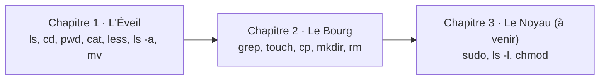

# Scénario — Terminus en français

*Apprendre la ligne de commande Linux en jouant.* Jeu de la section Jeux
(`/jeux/terminus/`). Code : `src/scripts/terminus/` (moteur `shell.ts`,
briques `monde.ts`, un fichier par chapitre dans `chapitres/`).

## Principes

- **Proche de l'original** : même idée (un lieu = un dossier, un objet = un
  fichier) et même progression des commandes que
  [Terminus](https://web.mit.edu/mprat/Public/web/Terminus/Web/main.html),
  créé au MIT par Shawn Conrad et Michele Pratusevich.
- **Nos propres textes** : l'histoire, les lieux et les dialogues sont écrits
  pour Les rouages du net, ce n'est pas une traduction.
- **De vraies commandes, de vrais comportements** : mêmes chemins (`..`, `~`,
  `/`), mêmes règles (`mv` renomme, `cp` copie, `rm` est définitif, les
  jokers `*` sont développés avant la commande, comme le fait le shell). Les
  écarts volontaires sont signalés dans le code et listés ci-dessous.
- **Chapitres séparés** : chacun a son monde, ses commandes et sa fin. La
  progression est gardée dans le navigateur (`localStorage`, clé
  `rouages-terminus`), chapitre par chapitre. Un chapitre s'ouvre quand le
  précédent est terminé.
- **Plusieurs histoires possibles** : le moteur ne dépend d'aucune histoire.
  Une nouvelle histoire = une nouvelle série de chapitres.

### Écarts volontaires avec un vrai Linux

| Commande | Dans le jeu | Sous Linux |
|---|---|---|
| `less` | affiche tout, comme `cat` | affiche page par page (`q` pour quitter) |
| `mv` | ne déplace que des objets (fichiers) | déplace aussi les dossiers |
| `rm -r`, `cp -r` | refusés | effacent / copient des dossiers entiers |
| `grep` sans résultat | « (aucune ligne ne contient …) » | n'affiche rien |
| `man` | une ligne de résumé | une longue page de manuel |

## Histoire 1 : l'Effaceur

Une créature, l'Effaceur, parcourt le royaume et efface tout ce qu'elle
touche. On découvrira qu'elle n'est pas méchante : c'est un programme qui
obéit à un ordre ancien, « tout effacer », écrit par erreur dans le Noyau.
Morale technique : un programme fait ce qu'on lui a dit, pas ce qu'on voulait.

### Chapitre 1 — L'Éveil (fait)

Correspond au niveau 1 de l'original (Académie, grotte, rocher, portail).

| Lieu | Énigme | Commande apprise |
|---|---|---|
| Maison | lire la lettre de l'amie | `ls`, `cat` |
| Foret, Clairiere | panneau, vieille dame (touche Tab, flèche ↑) | `cd`, `cd ..`, `pwd` |
| Academie/SalleDExercice | ranger la grenouille dans la Boite | `mv objet Lieu` |
| Academie/Cours | manuel, chemins, fichier caché `.note_secrete` | `man`, `~`, `/`, `ls -a` |
| Grotte/SalleHumide | pousser le rocher dans le lieu parent | `mv rocher ..` |
| ChambreDePierre | renommer la vieille clé en `cle`, trouver `.Portail` | `mv` pour renommer, `ls -a` |

### Chapitre 2 — Le Bourg (fait)

Correspond au niveau 2 de l'original (bibliothèque, ferme, atelier, pont,
clairière, ronces, trolls).

| Lieu | Énigme | Commande apprise |
|---|---|---|
| Bibliotheque | trouver quel livre parle du levier, puis le levier caché | `grep levier *`, `ls -a` |
| Reserve | lire la chronique de l'Effaceur | `grep`, `grep -i` |
| CheminRocailleux | rocher trop lourd pour `mv` | `rm` (et pas de corbeille) |
| Ferme | trois épis pour le fermier | `cp` |
| Atelier | fabriquer un engrenage, puis cinq | `touch`, `cp` |
| PontCasse | fabriquer la planche manquante | `touch` |
| Clairiere | reconstruire la maison (un lieu) | `mkdir` |
| SentierSombre | ronces impossibles à déplacer | `rm` |
| GrotteDesTrolls | nourrir le troll sans retourner à la ferme | `cp ~/…/epi .` (chemin complet, `.`) |
| Cage | libérer Nour | — |

### Chapitre 3 — Le Noyau (proposition)

Correspond à la fin de l'original (toboggan, fichiers du noyau, `sudo`).

- **Le Toboggan** mène au Noyau : un lieu où presque tout appartient à
  `root`, la « racine ». `ls -l` révèle les permissions (`rwx`) et les
  propriétaires.
- **Permission refusée** : on ne peut ni lire ni effacer certains fichiers.
  Un ancien manuel explique `sudo` (« fais-le en tant que root ») et ses
  dangers. Le mot de passe se trouve avec `grep` dans des journaux.
- **Protéger le Bourg** : sous Linux, effacer un fichier dépend du droit
  d'écriture **sur le dossier**. `chmod -w` sur un lieu empêche l'Effaceur d'y
  effacer quoi que ce soit (vrai comportement, bonne leçon).
- **Le dénouement** : l'Effaceur est un *démon* (le vrai nom des programmes
  qui tournent en arrière-plan sous Unix). Son ordre est dans un fichier
  `ordres` appartenant à root. On le renomme ou le corrige avec `sudo`, et
  l'Effaceur redevient ce qu'il était au début : un rangeur.

## Autres histoires (idées)

Chaque histoire est indépendante : on peut y jouer sans avoir fini l'Effaceur.

| Histoire | Pitch | Commandes | Lien avec le site |
|---|---|---|---|
| **Le Datacenter** | Premier jour de stage dans une salle de serveurs : un site est en panne, il faut comprendre pourquoi en lisant les journaux. | `head`, `tail`, `wc`, `sort`, `uniq`, tubes `\|`, redirections `>` `>>`, `ps`, `kill` | Module « De l'Entrée à la page » (le serveur répond, erreurs 404/500/503) |
| **Le Paquet perdu** | Un message n'arrive pas : on suit sa trace de machine en machine. | `ping`, `traceroute`, `dig`, `curl -I` (simulés) | Module « De l'Entrée à la page » (DNS, voyage des paquets) |
| **La Machine à remonter le temps** | Une autrice voit son manuscrit abîmé ; on voyage dans ses versions pour le sauver. | `git init`, `add`, `commit`, `log`, `diff`, `checkout`, `branch` | Histoire de l'informatique (logiciel libre, travail collectif) |
| **Les Archives** | Une bibliothèque menacée de fermeture : retrouver, empaqueter et mettre à l'abri des documents. | `find`, `tar`, `gzip`, `chmod`, `du` | Module « Savoirs » (libre accès, préservation) |

## Pour ajouter un chapitre

1. Créer `src/scripts/terminus/chapitres/mon-chapitre.ts` qui exporte un
   `Chapitre` (voir `monde.ts`) : commandes connues, monde (`d()` pour un
   lieu, `f()` pour un objet), événements (condition → message, une seule
   fois) et l'événement final.
2. L'ajouter à `CHAPITRES` dans `chapitres/index.ts`.
3. Vérifier qu'on peut le finir : une partie complète jouée par un script
   (voir la PR du chapitre 2), puis dans Chromium à 1000 et 375 px.
